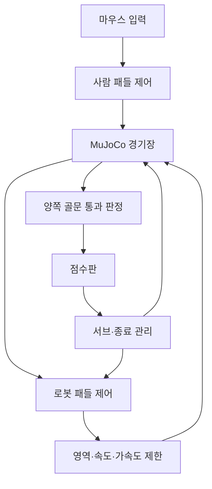

# 에어하키 1:1 시스템 구조 v0

## 한 판의 동작

새 경기는 0:0에서 사람이 먼저 서브한다. 플레이 중에는 사람의 마우스 입력과 로봇 제어기가 각각 자기 패들을 움직인다. 퍽이 골문을 완전히 통과하면 점수판이 득점을 한 번 기록한다. 결승점 전에는 실점자 쪽에 퍽을 재배치하고, 한쪽이 3점을 얻으면 경기를 종료한다.

## 모듈 관계

## 모듈 간 인터페이스

| 보내는 쪽 → 받는 쪽 | 전달값 | 단위 | 시점과 용도 |
|---|---|---|---|
| 마우스 입력 → 사람 패들 제어 | 화면 좌표 → 경기장 목표 위치 (x, y) | 픽셀 → m | 입력을 받을 때 좌표를 변환하고 사람 진영 안으로 제한한다. |
| MuJoCo → 로봇 제어 | 퍽 위치·속도, 로봇 패들 위치 | m, m/s | 제어 주기마다 읽어 접근·반구 목표를 정한다. |
| 로봇 제어 → 이동 제한 → MuJoCo | 목표 위치, 제한을 적용한 이동 명령 | m, m/s | 제어 주기마다 로봇 진영, 명령 속도, 명령 가속도 한계를 적용한다. |
| MuJoCo → 골문 판정 | 퍽의 이전·현재 위치, 반지름, 골문 위치와 폭 | m | 물리 스텝마다 어느 골문 입구를 통해 퍽 전체가 통과했는지 확인한다. |
| 골문 판정 → 점수판 | `in_player_goal`, `in_robot_goal` | 참/거짓 | 같은 랠리의 골을 한 번만 득점으로 기록한다. |
| 점수판 → 서브·종료 관리 | 양쪽 점수, 다음 서브 담당자, 승자 | 점, 사람/로봇/없음 | 득점 후 퍽 재배치 또는 경기 종료를 선택한다. |
| 서브·종료 관리 → MuJoCo·로봇 제어 | 퍽 재배치 위치, 서브 차례, 타격 허용 상태 | m, 상태값 | 재배치 중 이전 타격을 취소하고 적법한 서브로 다음 랠리를 시작한다. |

## 단위와 시간 기준

MuJoCo 장면의 길이 단위는 m다. 3일차에 작성한 오른쪽 골라인 함수 `has_fully_crossed_goal_line()`의 입력 단위는 mm다. 두 코드를 연결할 때는 경계에서 중심 좌표·반지름·골라인 좌표 세 값을 모두 m에서 mm로 변환한다. 예를 들어 장면의 오른쪽 골라인 +0.600m는 함수 입력에서 +600mm다.

장면 XML의 물리 스텝은 0.002초다. 속도 명령 변화로 가속도를 계산할 때는 실제로 두 명령을 보낸 시간 간격을 사용한다.

## 안전 고려사항

| 방지할 상황 | 감지 | 대응 및 확인 기준 |
|---|---|---|
| 패들 외곽이 중앙선을 넘거나 벽을 통과 | 패들 중심과 반지름으로 실제 외곽 위치를 계산 | 목표를 자기 진영 안으로 제한하고, 매 물리 스텝에서 실제 경계 이탈 0회를 확인한다. |
| 먼 목표로 이동하거나 방향을 반전할 때 과도한 로봇 명령 발생 | 평면 명령 속도의 크기와 연속 명령 간 속도 변화량을 기록 | 명령 속도 1.0m/s 이하, 명령 가속도 3.0m/s² 이하를 확인한다. 대각선 이동도 같은 기준을 쓴다. |
| 득점 전 타격 명령이 다음 서브나 경기 종료 뒤에 실행 | 랠리 종료, 재배치, 서브 대기, 경기 종료 상태를 확인 | 지난 랠리의 타격 목표를 취소한다. 재배치 중·종료 후 이전 타격 명령 실행은 0회여야 한다. |

## 현재 구현과 다음 연결 지점

- 장면 v0: [MuJoCo 경기장](../scenes/air_hockey.xml)을 작성하고 로컬 뷰어에서 열었다.
- 판정 코드: [judge.py](../src/judge.py)와 [단위 테스트](../tests/test_judge.py)로 오른쪽 골라인 경계, 중복 득점, 실점자 서브권, 사람의 3점 선취 종료를 검증했다.
- 다음 연결: 왼쪽 골문과 골문 폭 판정, 첫 서브 대기 상태, 득점 후 실제 퍽 재배치, 마우스 좌표 변환, 로봇 패들 제어를 시뮬레이션에 연결한다.
- 성능 확인: 정지 퍽 반구를 먼저 시험하고, 이후 제한 속도의 퍽으로 ‘사람 타격 → 로봇 반구 → 사람 재타격’을 확인한다.