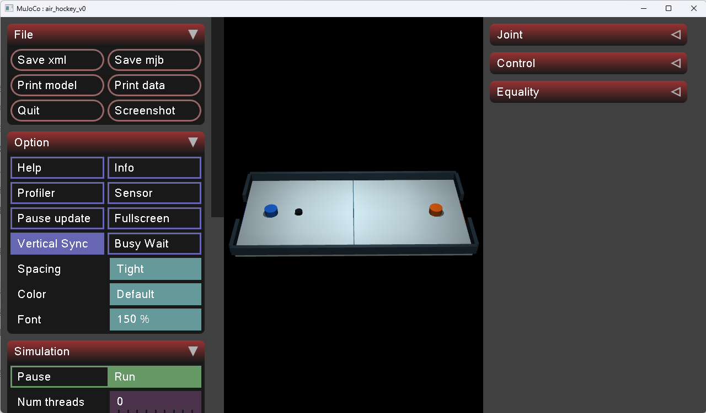

# 에어하키 1:1 장면 설계 v0

## 장면의 목적

혼자 온 이용자가 마우스로 한쪽 패들을 조작하고, 반대편에서는 로봇이 퍽을 받아치는 1:1 에어하키 경기를 구현한다. 장면 v0에서는 경기장, 양쪽 골문, 패들 두 개와 퍽 한 개의 위치 및 이동 자유도를 정의한다.

- 장면 파일: [air_hockey.xml](../scenes/air_hockey.xml)
- 실행 확인: 2026-11-26, 로컬 MuJoCo 뷰어에서 `air_hockey_v0` 로드 및 화면 캡처

## 좌표계와 배치

아래 위치는 경기장을 위에서 내려다본 설계 기준이다. 경기장 바닥 중앙이 원점이고, 사람 진영에서 로봇 진영으로 향하는 방향이 +x, 위에서 볼 때 화면 위쪽이 +y다. 길이 단위는 m다.

| 구성 요소 | 위치와 크기 | 설계 의도 |
|---|---|---|
| 경기장 | 내부 길이 1.20, 폭 0.60 | 사람이 왼쪽, 로봇이 오른쪽을 사용한다. |
| 중앙선 | x=0 | 양쪽 패들의 활동 영역을 나눈다. 퍽은 자유롭게 통과한다. |
| 사람 골문 | 왼쪽 끝 x=-0.60, 입구의 y 범위 -0.10~+0.10 | 퍽이 왼쪽 골문으로 완전히 들어가면 로봇이 득점한다. |
| 로봇 골문 | 오른쪽 끝 x=+0.60, 입구의 y 범위 -0.10~+0.10 | 퍽이 오른쪽 골문으로 완전히 들어가면 사람이 득점한다. |
| 사람 패들 | 파란색, 중심 초기 위치 (-0.45, 0), 반지름 0.035 | 첫 서브 때 퍽 뒤에서 시작한다. |
| 로봇 패들 | 주황색, 중심 초기 위치 (+0.45, 0), 반지름 0.035 | x·y 두 축으로 자기 진영 안에서 이동한다. |
| 퍽 | 중심 초기 위치 (-0.30, 0), 반지름 0.020 | 사람 패들과 중앙선 사이에서 시작한다. |

## 이동과 충돌

패들은 각각 x·y 방향 슬라이드 관절 두 개를 사용한다. 퍽은 x·y 이동과 수직축 회전이 가능하다. 높이는 고정하며, 끝 벽을 두 조각으로 나눠 양쪽 골문 입구를 열어 두었다. 바닥에 표시한 중앙선과 골라인은 퍽과 충돌하지 않는다.

패들의 반지름을 고려한 **중심의 설계상 이동 범위**는 다음과 같다. 실제 시뮬레이션에서 경계를 지키는지는 움직이는 동안 별도로 측정한다.

| 패들 | 중심 x 범위(m) | 중심 y 범위(m) |
|---|---|---|
| 사람 | -0.565 ~ -0.035 | -0.265 ~ +0.265 |
| 로봇 | +0.035 ~ +0.565 | -0.265 ~ +0.265 |

## 골라인 판정 예시

로봇 골문 한가운데에서 퍽이 오른쪽으로 들어갈 때 마지막으로 선을 지나는 부분은 퍽의 왼쪽 끝이다. 퍽 중심이 x=0.620m이면 왼쪽 끝은 x=0.600m이므로 선에 닿아 있다. 중심이 x=0.621m이면 왼쪽 끝도 x=0.601m가 되어 선을 완전히 통과한다.

왼쪽 골문에서는 반대로 퍽의 오른쪽 끝이 x=-0.600m보다 작아져야 한다. 경기에서는 두 경우 모두 골문 입구를 통해 들어왔는지도 함께 확인한다.

## 검증 상태

- 실행 확인: 장면 XML 로드 및 뷰어 화면 캡처.
- 후속 검증: 실제 패들 이동 영역, 벽과 퍽의 충돌, 양쪽 골문 통과, 마우스 조작, 속도를 제한한 로봇 반구.